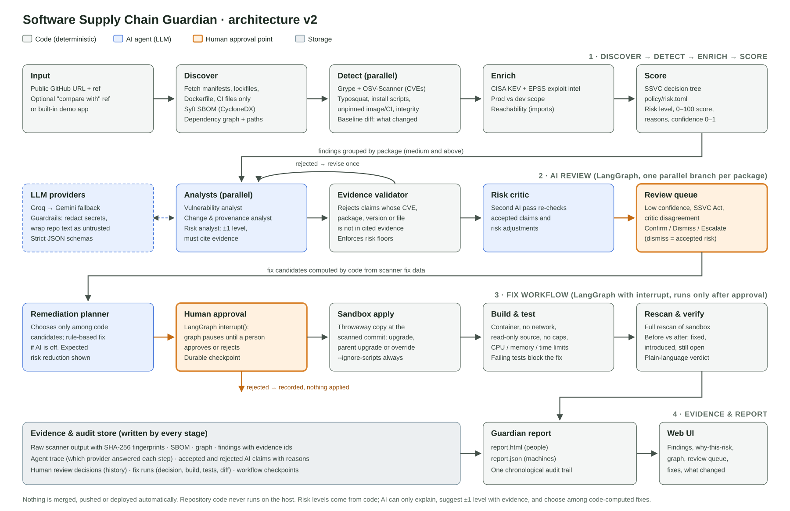

# Software Supply Chain Guardian

Guardian takes a repository from discovery to verified remediation: SBOM and dependency graph → known vulnerabilities and suspicious changes → explainable risk with a confidence score → AI explanations checked against evidence → human review → an approved fix that is built, tested and rescanned in a sandbox → an evidence-based report.



- [Responsible AI & Security note](docs/responsible-ai-security.md): where AI is used, how hallucinations are controlled, what needs human approval, how secrets are protected.
- [Architecture v2 design](docs/designs/guardian-v2-architecture.md): the reasoning behind the risk engine, confidence score and agents.

## Web UI quick start

You need Python 3.11+, Node.js 20+, Docker or Podman (scanner images and the fix sandbox), and npm.

```sh
python3.11 -m venv .venv && source .venv/bin/activate
pip install -e '.[dev]' -r Bosch_Guardian_Clean/backend/requirements.txt
bash scripts/prefetch.sh                # scanner images and the Grype database
cp .env.example .env                    # then fill in the keys you have (see below)

cd Bosch_Guardian_Clean/backend && python -m uvicorn app.main:app --port 8000
# second terminal
cd Bosch_Guardian_Clean/frontend && npm install && npm run dev   # http://127.0.0.1:5173
```

| Setting in `.env` | Purpose |
|---|---|
| `GUARDIAN_LLM_PROVIDER` | `groq`, or `none` for a fully offline run (the risk engine and rule-based fixes still work) |
| `GUARDIAN_LLM_API_KEY` | Key for the primary provider |
| `GUARDIAN_LLM_FALLBACKS`, `GEMINI_API_KEY` | Fallback chain, e.g. `gemini`, used when the primary fails or is rate-limited |
| `GITHUB_TOKEN` | Optional; raises the GitHub API limit from 60 requests per hour. Stays in the backend |
| `GUARDIAN_SCAN_DIR` | Where scans, decisions and fix runs are stored |
| `GUARDIAN_AI_MIN_RISK`, `GUARDIAN_LLM_CONCURRENCY` | Lowest risk level sent to the AI (default `medium`) and the number of parallel AI branches (default 4) |

### Demo walkthrough (Day 2 flow)

1. **Scan.** Click **Scan the built-in demo app** (local, no network), or paste a public GitHub URL. Fill in **Compare with** to see what changed since an older tag.
2. **Prioritize.** The findings are ranked Critical → Low. Click one to see **Why this risk?**: exploitation, scope, attack vector, impact, the SSVC decision, the confidence score and any AI adjustment.
3. **Review.** The **Review queue** tab lists the uncertain findings. Confirm, dismiss (records an accepted risk, so a note is required) or escalate each one.
4. **Fix.** The **Fixes** tab shows each proposed fix with its expected risk reduction, rollback and compatibility risk. Click **Approve**: the LangGraph workflow resumes from its pause, applies the fix in a sandbox, builds, runs the tests in a no-network container, rescans and shows before vs. after.
5. **Report.** **Open full report** (`report.html`) or download `report.json`. Both cover the original findings and evidence, the approved actions, the validation results, the remaining and accepted risks, and the audit trail.

## Setup

Use Python 3.11 or later and Docker for live scanner stages.

```sh
python -m pip install -e '.[dev]'
python -m pytest
python -m scripts.generate_schemas
```

The demo targets in the team plan are Juice Shop (`c9f9922`) and RailsGoat (`f5951f1`). The scanner versions verified by the team are Grype `0.122.1` and OSV-Scanner `2.7.1`.

Copy `.env.example` to `.env` for local settings. Run `bash scripts/prefetch.sh` for the pinned images and Grype database. OSV queries its advisory service during scans. See [scanner setup](docs/scanners.md) for details. The report records the tool metadata from each run. Leave the AI provider as `none` for an offline demo.

## Run a local scan

```sh
guardian scan targets/juice-shop --out artifacts/juice-shop --no-llm
guardian scan targets/railsgoat --out artifacts/second-target --no-llm
```

Open `report.html` inside each output folder. The same folder contains the JSON artifacts and the Markdown report. Exit codes are 0 for complete, 2 for partial, and 1 for failed. Review the scan header for any missing stages.

## Relevance, entry paths and the demo app

Every vulnerability is traced from the application to the vulnerable package (each hop, the
direct dependency that introduces it, number of paths, production or dev scope) and given a
relevance verdict from recorded signals: relevant, likely relevant, unknown or low relevance.
The verdict never says "safe". `demo/vulnerable-app` is a local, deliberately vulnerable app
with a synthetic malicious-style package for the live demo:

```sh
guardian scan demo/vulnerable-app --out artifacts/demo --no-llm
```

Safety rules, the open-source inventory and the changelog: [demo app](demo/vulnerable-app/README.md),
[open-source components](docs/open-source.md), [changes](docs/changes.md).

## Team integration

Live scans require the P1 inventory and graph modules, P2 scanner modules, and P3 detector registry. AI review and claim injection also require the P4 modules. A missing scan stage is recorded in the report, and available stages keep running.

| Owner | Provides | Consumed by |
| --- | --- | --- |
| P1 | SBOM, components and dependency edges | P2, P3, P5 |
| P2 | Scanner findings and evidence | P4, P5 |
| P3 | Anomaly findings, evidence and coverage rows | P4, P5 |
| P4 | AI claims, validation status and rejection reasons | P5 |
| P5 | Shared models, schemas, runner, risk policy, coverage and reports | All |

See [the demo walkthrough](docs/P5_DEMO.md) for the live sequence.
