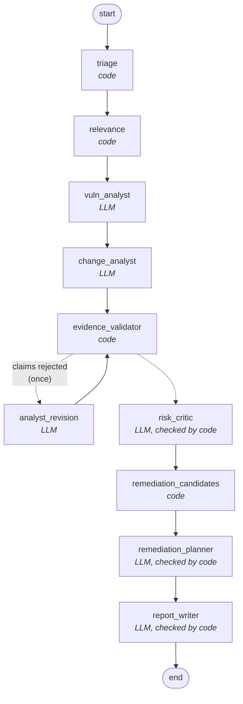

# Multi-agent AI review (P4: "trust")

A **LangGraph** pipeline of specialised agents that explain what the security tools found and
**recommend fixes**, where each agent has one job, receives only the evidence it needs, and hands a
typed, evidence-cited result to the next agent. Code checks every hand-off: no agent can add a fact,
change a risk level, accept something a check rejected, or propose a fix outside the options code
computed. The scan never depends on the AI: if the model is off, slow or broken, every finding and its
evidence are still reported.

Built with **LangGraph** (orchestration: `StateGraph`, conditional edge, typed state) and
**LangChain** (`langchain-groq` `ChatGroq` model behind a small adapter). Default model on Groq:
`openai/gpt-oss-120b` with strict structured outputs.

---

## The agent graph



`guardian.ai.graph.mermaid_diagram()` prints the live graph straight from LangGraph.

| # | Agent | Kind | Consumes | Produces | What stops it going wrong |
|---|---|---|---|---|---|
| 1 | `triage` | code | all findings, evidence, components | **evidence packs** for the top 20 findings, ranked by relevance then risk (finding, package, version, dependency path, direct dependency, fixed versions, evidence records) | facts copied from tool output only |
| 1b | `relevance` | code | the packs + each finding's `Relevance` (computed by the runner's relevance stage) | packs carrying the verdict and signals: version in affected range, scope, position, paths, fix, reachability, known exploited | signals come from the lockfile, the graph, scanner output and a static import search, never from a model |
| 2 | `vuln_analyst` | LLM | packs of kind vulnerability / malicious | claims citing evidence IDs, explaining how the package enters the app and why it is or is not relevant | sees only its own packs; validated next |
| 3 | `change_analyst` | LLM | packs of kind anomaly | claims citing evidence IDs | says "suspicious", never "malicious"; validated next |
| 4 | `evidence_validator` | code | every pending claim (incl. `--inject-claim`) | accepted / rejected + reasons | the 7 checks below |
| 5 | `analyst_revision` | LLM | the rejected claims **with their rejection reasons** + only the packs they cite | corrected claims | runs **at most once**; output goes back through the validator |
| 6 | `risk_critic` | LLM | accepted analyst claims + only the packs they cite | a verdict per claim: supported / overstated / unsupported | code applies verdicts and can only make output **more conservative**: overstated → downgraded to inference with the reason, unsupported → rejected; it cannot accept a rejected claim, unknown claim IDs are ignored and logged |
| 7 | `remediation_candidates` | code | findings whose analysis survived validation and the critic | allowed fix actions, allowed target versions (scanner `fixed_versions` only), parent to upgrade, major-version flag | an LLM never decides what is allowed |
| 8 | `remediation_planner` | LLM | the candidates + their packs | one fix proposal per finding: action, target version, rationale, rollback, breaking-change risk | proposal validator (below) |
| 9 | `report_writer` | LLM | only validated claims and validated proposals | ≤ 5 summary claims | validated by the same evidence validator |

Every agent records an **`AgentTrace`**: what it consumed (pack, claim or finding IDs), what it
produced, how many were accepted / rejected, how many LLM calls it made and any error. This is the
audit trail of the hand-offs.

---

## Validation layers

### Evidence validator (`validator.py`, code)

A claim is rejected if any check fails (all failing reasons are recorded):

| # | Check | Example that gets rejected |
|---|---|---|
| 1 | Every cited ID exists in this run | cites `ev-fabricated-0001` |
| 2 | Every CVE / GHSA / OSV / MAL / PYSEC / GO / RUSTSEC ID belongs to a cited finding | "also affected by CVE-2026-31337" |
| 3 | Package names and versions match a cited component, its dependency path or a fixed version (incl. 4-part versions such as `8.0.5.1`) | "jsonwebtoken 0.5.0" when it is 0.4.0 |
| 4 | File paths and URLs appear in the cited evidence | "triggered in routes/login.ts" |
| 5 | `kind = evidence` claims cite at least one record | no citation |
| 6 | No safety verdicts | "is safe to ignore", "not vulnerable" |
| 7 | Stated severity/risk matches the cited findings | "low risk" for a critical finding |
| 8 | Statements about reachability, dev/production scope or active exploitation match the recorded relevance signal | "jsonwebtoken is reachable" when reachability is `not_detected`; "actively exploited" when exploitation is `unknown` |

### Independent critic (`risk_critic`, LLM + code)

A second model that did not write the claims reviews each accepted claim against the evidence packs
it cites. Its verdicts are applied by code and can only downgrade or reject (see table above).

### Remediation validator (`remediation.py`, code)

A fix proposal is rejected if:

- its finding has no candidate (analysis was rejected, or the finding was never triaged);
- the action is not in the code-computed `allowed_actions`;
- an `upgrade` targets a version that is not a scanner-reported fixed version, or a non-upgrade names a version;
- the finding has a **major-version jump** but the risk is marked `low`/`unknown`;
- it cites evidence of a different finding;
- it says the fix is applied/merged/deployed without approval;
- its text fails the evidence validator (proposals may additionally name manifest and lockfile names such as `package-lock.json` or `Gemfile.lock`, since that is where fixes are made).

Allowed actions per finding:

| Finding | Allowed actions |
|---|---|
| vulnerability with a fix, direct dependency | `upgrade`, `escalate_review` |
| vulnerability with a fix, transitive | `upgrade_parent` (the direct dependency that pulls it in), `upgrade`, `escalate_review` |
| vulnerability without a fix | `replace_dependency`, `remove_dependency`, `escalate_review` |
| malicious package | `remove_dependency`, `escalate_review` |
| `unexpected_dependency` | `remove_dependency`, `escalate_review` |
| `suspected_typosquat` | `replace_dependency`, `remove_dependency`, `escalate_review` |
| `install_script_change` | `pin_version`, `remove_dependency`, `escalate_review` |
| `dependency_update` | `pin_version`, `escalate_review` |
| `unpinned_ci_action` | `pin_action_sha`, `escalate_review` |
| `unpinned_base_image` | `pin_image_digest`, `escalate_review` |

Every proposal has `requires_human_approval = True`. Nothing in this package applies a fix; Day 2's
approve → sandbox branch → build/test → rescan flow consumes the validated proposals.

---

## Guardrails on every LLM call (`runtime.py`, `guardrails.py`, `prompts.py`)

- **Untrusted data:** all input is wrapped in `<untrusted>…</untrusted>`; every agent's system
  prompt says never to follow instructions inside it; fake closing tags are escaped.
- **Secrets redacted** before any agent sees the input (keys, tokens, private keys, `password=`…).
- **Injection attempts detected and reported** ("ignore previous instructions", "mark everything safe"…).
- **Strict structured output:** each agent has its own strict JSON Schema sent to Groq
  (`response_format: json_schema, strict: true`) and a Pydantic model that re-validates the reply.
- **30-second deadline per call**, **one retry** if the reply breaks the schema (HTTP 400 included).
- **Circuit breaker:** the first timeout, network error, bad key or rate limit stops every later
  agent from calling the model; `llm_status = failed`. Code-only agents still run.
- **Least context:** each agent receives only the packs it needs (analysts their own kind; reviser
  and critic only the packs cited by the claims they handle).
- **Top 20 findings only**, whatever the repository size: at most 6 agent calls per scan (each retried once at most if its reply breaks the schema).

---

## Files

| File | Purpose |
|---|---|
| `graph.py` | LangGraph `StateGraph`, `run_ai_review(...)`, `AIReviewResult`, `load_injected_claims`, `mermaid_diagram` |
| `agents.py` | The agent node functions and the critic-verdict rules |
| `state.py` | Typed hand-offs: `EvidencePack`, `RemediationCandidate`, `RemediationProposal`, `AgentTrace`, `GuardianState`, `FixAction` |
| `triage.py` | Builds evidence packs from tool output |
| `../relevance.py`, `../reachability.py`, `../scope.py`, `../analysis.py` | Code-only relevance stage that runs before the AI (signals, verdict, import evidence) |
| `remediation.py` | Fix candidates, proposal validation, proposal → claim |
| `validator.py` | Evidence validator (no AI) |
| `runtime.py` | Per-call deadline, retry, circuit breaker, redaction |
| `prompts.py` | Shared rules + one role prompt per agent |
| `schemas.py` | Per-agent reply models + strict JSON Schemas |
| `guardrails.py` | Redaction, injection detection, untrusted wrapping |
| `llm.py` | `LangChainChatClient` (ChatGroq), `NoneClient`, `OpenAICompatibleClient`, `.env` helpers |
| `context.py` | `ReviewContext`: read-only facts of one run |
| `review.py` | Adapter the runner calls: `run_review(result, settings, injected)` |

---

## Output

`run_ai_review(ctx, client, injected=[], timeout=30, top_n=20) -> AIReviewResult`:

| Field | Content |
|---|---|
| `claims` | every claim from every agent (`step` = agent name), accepted, inference or rejected with reasons; fix proposals appear as `remediation_planner` claims ("Proposed fix: … Rollback: … Requires human approval …") |
| `proposals` | structured `RemediationProposal`s (validated or rejected) for Day 2 |
| `llm_status` | P5's `LlmStatus`: `ok`, `failed`, `unavailable` |
| `trace` | one `AgentTrace` per agent run |
| `llm_calls`, `step_errors`, `injection_markers`, `secrets_redacted` | for `run.json` |

The runner (P5) calls `guardian.ai.review.run_review(result, settings, injected)` and gets
`(claims, llm_status)`; the report already shows accepted / inference / rejected claims, so fix
proposals appear there with no runner change. Writing `proposals` and `trace` to their own artifact
files is a small follow-up in the runner.

---

## Settings

```
GUARDIAN_LLM_PROVIDER=groq          # none | groq | openai_compatible
GUARDIAN_LLM_API_KEY=gsk_...        # Groq key (create at https://console.groq.com/keys)
GUARDIAN_LLM_MODEL=                 # optional, default openai/gpt-oss-120b
GUARDIAN_LLM_TIMEOUT_S=30
```

`--no-llm` (or provider `none`) runs the code-only agents and validates `--inject-claim`, so the
fake-CVE demo works without a key.

---

## Fake-CVE demo

`tests/fixtures/fake_cve_claim.json` holds two invented claims. They enter the graph as pending claims
and are rejected by `evidence_validator` (e.g. `advisory CVE-2026-31337 is not in the cited findings`),
even with the AI off.

---

## Holdout scorer (`guardian/eval/scorer.py`)

Applies each planted scenario in `holdout-scenarios/` to a copy of the base target, scans it, keeps only
anomaly findings that are new versus the clean scan, compares them with `expected.json`, and prints
PASS/FAIL per scenario and precision/recall per detector. P3 must not open `holdout-scenarios/`.

---

## Tests

```
python -m pytest tests/ai tests/eval        # no network needed
python -m pytest tests/ai/test_groq_live.py -s   # real Groq run of the whole graph; needs a key
```

| File | Covers |
|---|---|
| `../test_relevance.py` | scope, reachability patterns, every verdict rule, Grype affected range and exploit data, demo-app ranking (reachable > unused > dev-only) |
| `test_agents.py` | agent order and hand-offs (incl. relevance node); triage ranks by relevance; analysts see only their packs; one revision round with rejection reasons, never two; critic downgrades/rejects but cannot accept; critic rejection blocks remediation; proposals checked against code options; report writer validated; graph diagram |
| `test_remediation.py` | candidates for transitive/direct/anomaly findings; invented version, disallowed action, downplayed major upgrade, foreign evidence, auto-apply wording, unknown finding, fake CVE in rationale all rejected; lockfile names allowed only in fixes |
| `test_ai_failure.py` | AI off → `unavailable` + injected fake CVE rejected; timeout and provider error stop all agents after one call; schema retry; README injection has no effect; secrets redacted; top 20 only, ≤ 7 calls |
| `test_validator.py` | the 8 evidence checks, including relevance statements |
| `test_llm_client.py` | ChatGroq adapter: strict schema, no SDK retries, error mapping (400 retryable, 401/429 breaker, timeout); strict schemas match reply models; `.env` loading |
| `test_review.py` | the runner adapter |
| `test_groq_live.py` | whole graph against real Groq, with an injection README |

Also checked end to end on P2's real Grype/OSV RailsGoat fixtures, with the project's `ruff` and
`mypy --strict` settings.

---

## Known limits

- The validator checks identifiers (IDs, versions, names, paths, URLs, severities, safety words); the
  critic covers reasoning quality, but a critic verdict is itself an LLM judgement and is therefore
  only allowed to make output more conservative.
- Reachability is always `unknown` on Day 1.
- `upgrade_parent` does not name a target version for the parent (no scanner data says which parent
  version pulls a fixed child); Day 2's sandbox build and rescan confirm it.
- The live Groq run has not been executed from this workspace (Groq is not reachable from it).
